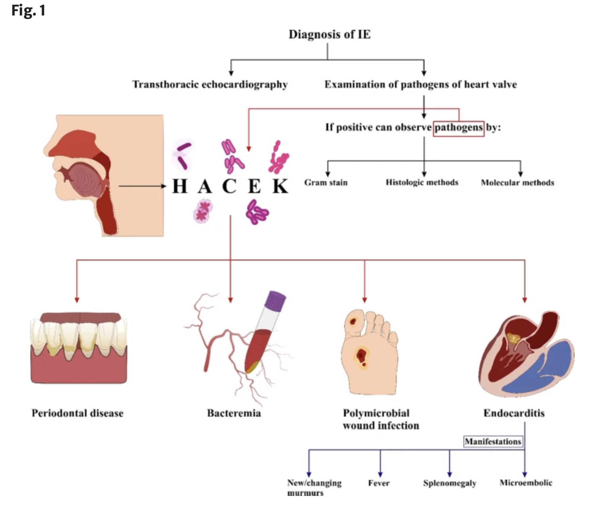
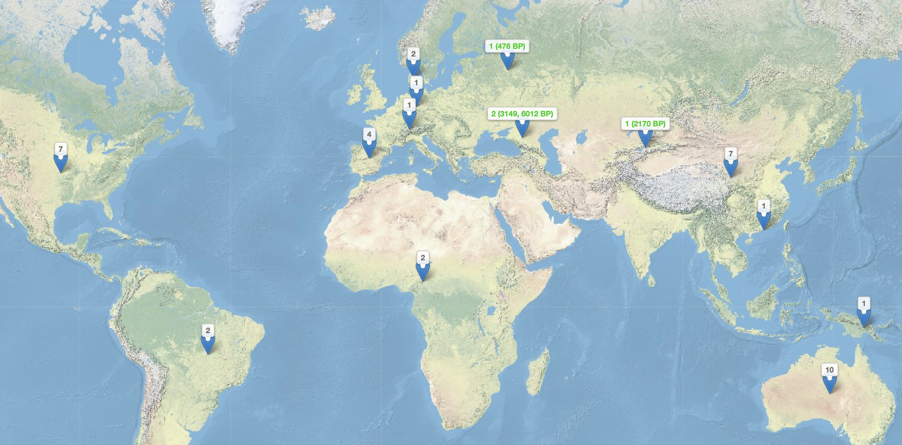
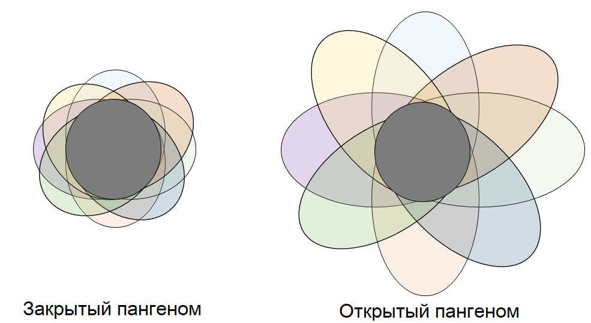
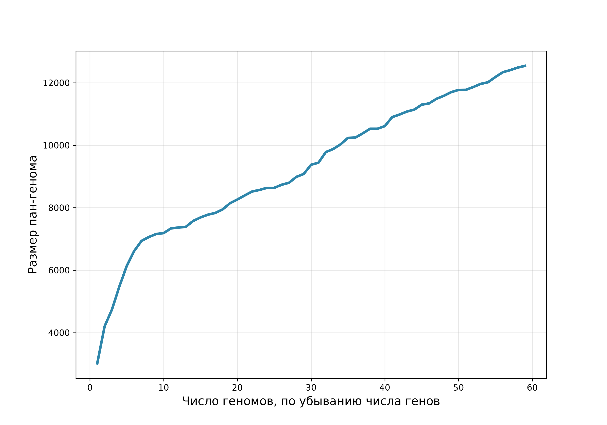
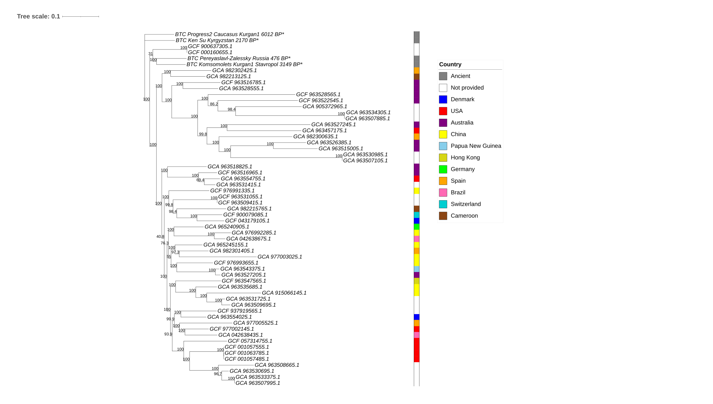
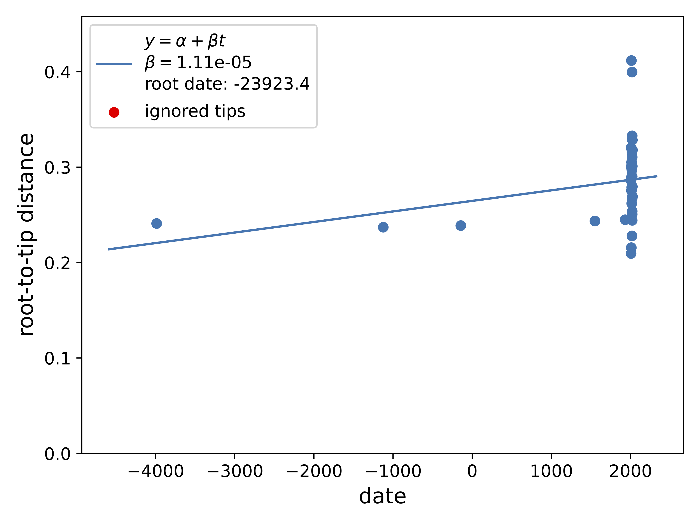

## Микроорганизмы группы HACEK

- Грамотрицательные бактерии группы HACEK (*Haemophilus*, A*Aggregatibacter actinomycetemcomitans*, *Cardiobacterium hominis*, *Eikenella corrodens* и *Kingella kingae*) входят в состав нормальной микрофлоры рта и верхних дыхательных путей человека

- Основная опасность этих маловирулентных микроорганизмов — способность вызывать медленно текущий инфекционный эндокардит (ИЭ) - часто на фоне уже поврежденных сердечных клапанов [@khaledi2022].

## Подострое течение: скрытое и медленное развитие ИЭ [@khaledi2022]

## Цели исследования

- **Пан-геномный анализ** современных (55 шт.) и древних представителей (4 шт. от БТК) *Cardiobacterium hominis*
- **ML дерево** на основе пан-геномного анализа:
  - Проверка кластеризации образцов по странам
  - Поиск сигнала датирования
- **Анализ** генов патогенности и антибиотико - резистентности:
  - Стал ли *Cardiobacterium hominis* опаснее?

## Карта сбора образцов

{#fig-map}

## Кривая насыщаемости пан-генома

::::: columns
::: column
{#fig-panexpl}
:::

::: column
{#fig-pancurve}
:::
:::::

## ML филогенетическое дерево (IQ-TREE) без аутгруппы

{#fig-mltree}

## Проекция ML дерева на карту

{#fig-map2}

## Регрессия «расстояние от корня — возраст образца»

{#fig-regr}

## Обнаруженные гены патогенности и антибиотикорезистентности

{#fig-genes1}

## Анализ генов патогенности

Выявленные гомологи (при пороге 70%) отвечают за базовые клеточные функции: адгезию, стресс-ответ, метаболизм:

- tapT (АТФаза пилей IV типа) и tufA (фактор элонгации) — высокая частота в референсах; связаны с адгезией
- msrA/B, hmbR, kdtA/waaA, pilU — единичные детекции.

**Вирулентность *Cardiobacterium hominis* в древних образцах:**

- Ни один из 6 целевых генов не выявлен (даже при сниженном пороге 70%/70%).
- Результат согласуется с классическими данными о «крайне низкой вирулентности» штамма [@ellner1979].

## Анализ генов антибиотикорезистентности

- Neisseria gonorrhoeae folP with mutation conferring resistance to sulfonamides - во всех древних образцах и большинстве других штаммов
- GCA_963509695.1 — одновременно детектированы antibiotic inactivation	APH(3''), antibiotic inactivation	APH(6), antibiotic inactivation	TEM beta-lactamase и sulfonamide resistant sul,glycopeptide resistance gene cluster vanT, folP
- GCA_963554755.1 — детектирован tet(A) - tetracycline antibiotic	antibiotic efflux	major facilitator superfamily (MFS) antibiotic efflux pump. Находка может быть первым молекулярным указанием на тетрациклиновую резистентность у C. hominis, что контрастирует с литературным тезисом о чувствительности [@ellner1979].
- vanT (vanG cluster) — детектирован у восьми референсных геномов . vanW (vanI cluster) — только у GCF_937919565.1. Высокая частота генов ванкомициновой резистентности, у C. hominis не описанная

## Выводы

1.  Пан-геном *C. hominis* **открытый**, коровых генов - 451

2.  ML-дерево **не подтверждает** пространственную структуру, временного сигнала в выборке нет

3.  При стандартном пороге **факторов вирулентности не выявлено** — вид действительно характеризуется крайне низкой вирулентностью; древние образцы не несут ни одного гена патогенности даже при порого 70%.

4.  Картина резистентности мозаична: большинство сигналов — единичные, но выделяются GCA_963509695.1 (полирезистентность) и GCA_963554755.1 (tet(A)), а высокая частота vanT требует отдельного обсуждения и фенотипической проверки.

## Список литературы {.allowframebreaks}

::: {#refs}
:::