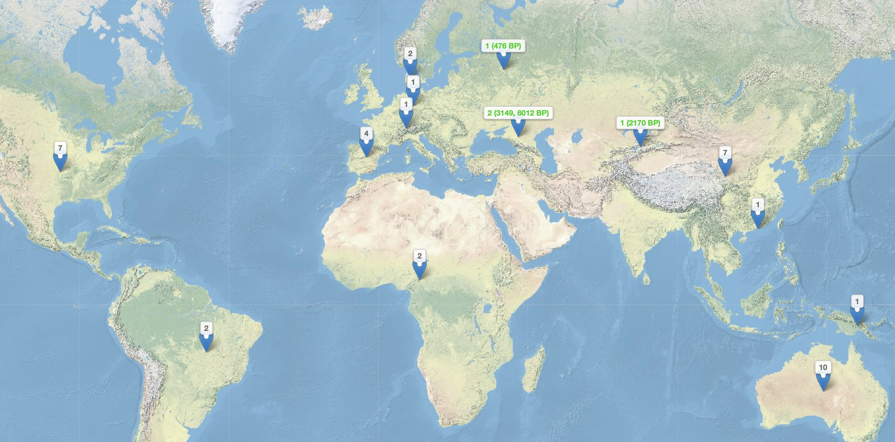
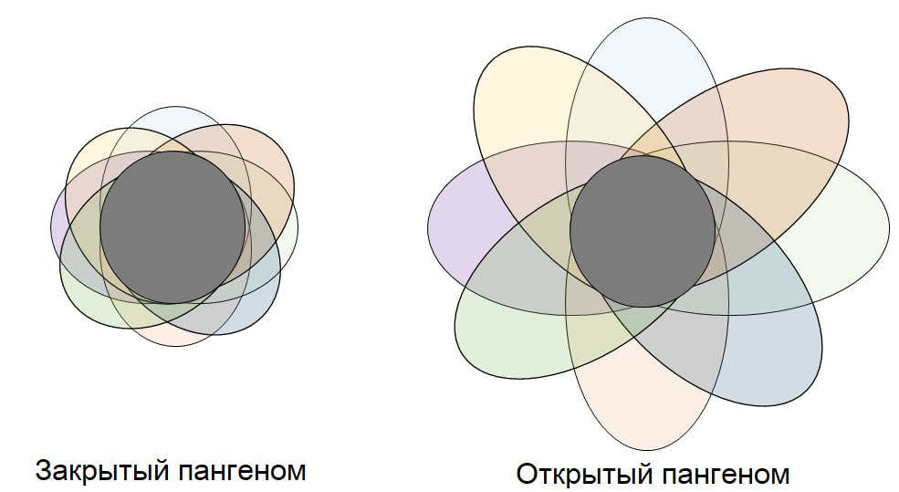
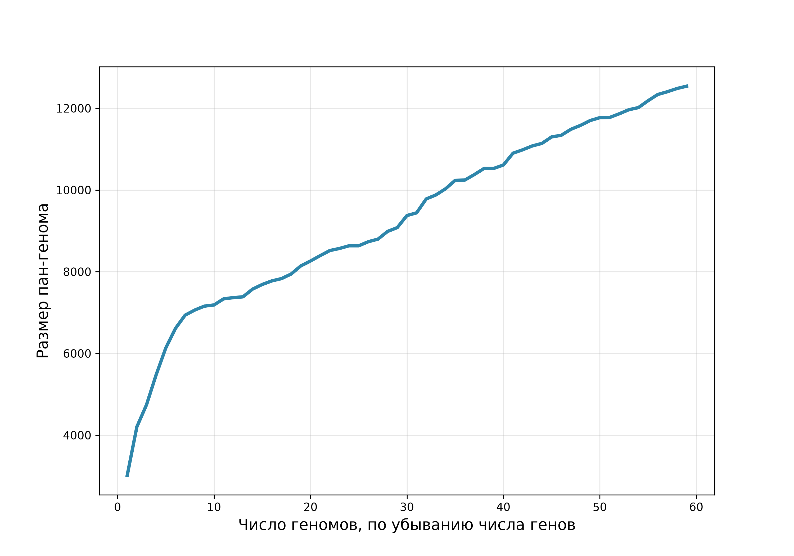
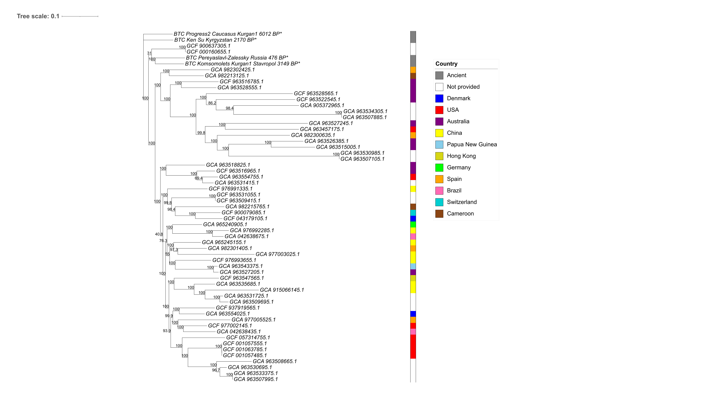
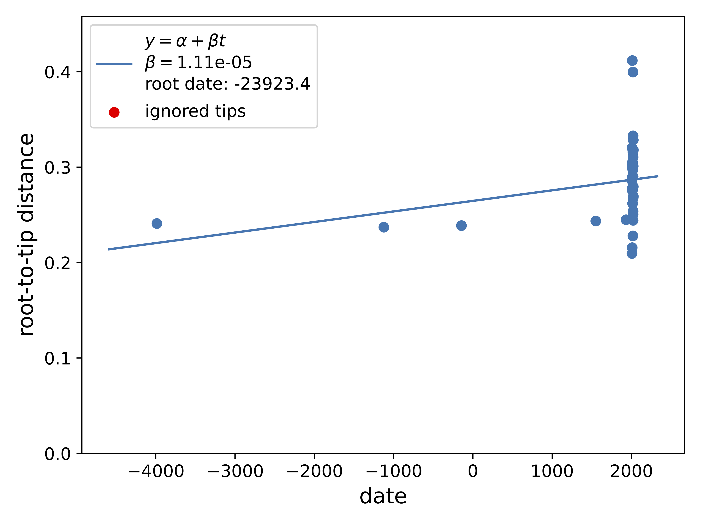
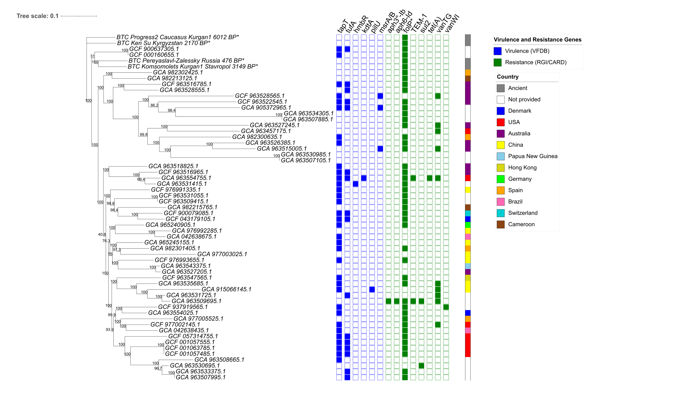

## Микроорганизмы группы HACEK

- Грамотрицательные бактерии группы HACEK (*Haemophilus* spp., *Aggregatibacter actinomycetemcomitans*, *Cardiobacterium hominis*, *Eikenella corrodens* и *Kingella kingae*) входят в состав нормальной микрофлоры полости рта и верхних дыхательных путей человека.

- Основная опасность этих маловирулентных микроорганизмов — способность вызывать медленно текущий инфекционный эндокардит (ИЭ), часто на фоне уже повреждённых или протезированных клапанов сердца [@khaledi2022; @chambers2013].

## Подострое течение: скрытое и медленное развитие ИЭ 

![**Диагностика ИЭ**: ЭхоКГ + микробиология (бактериемия, заболевание пародонта, раневые инфекции) + клиника (лихорадка, шумы в сердце). [@khaledi2022]](results/figures/HACEK.png){#fig-HACEK}

## Цели исследования

- **Пан-геномный анализ** современных (n = 55) и древних (n = 4, из зубного налёта археологических образцов) штаммов *C. hominis*.
- **ML-филогения** по коровому выравниванию:
  - проверка кластеризации образцов по странам;
  - поиск сигнала времени и, при его наличии, построение датированного дерева.
- **Анализ генов факторов вирулентности** (VFDB) **и детерминант антибиотикорезистентности** (CARD/RGI).

## Карта сбора образцов

{#fig-map}

## Кривая насыщаемости пан-генома

::::: columns
::: column
{#fig-panexpl}
:::

::: column
{#fig-pancurve}
:::
:::::

## ML филогенетическое дерево (IQ-TREE) без аутгруппы

{#fig-mltree}

## Проекция ML дерева на карту

{#fig-map2}

## Регрессия «расстояние от корня — возраст образца»

{#fig-regr}

## Обнаруженные гены патогенности и антибиотикорезистентности

{#fig-genes1}

## Анализ генов патогенности

Выявленные гомологи (при пороге 70%) отвечают за базовые клеточные функции: адгезию, стресс-ответ, метаболизм:

- *tapT* (АТФаза пилей IV типа) и *tufA* (фактор элонгации) — высокая частота в референсах; связаны с адгезией;
- *msrA/B*, *hmbR*, *kdtA/waaA*, *pilU* — единичные детекции.

**Вирулентность *Cardiobacterium hominis* в древних образцах:**

- Ни один из 6 целевых генов не выявлен (даже при сниженном пороге 70%/70%).
- Результат согласуется с классическими данными о «крайне низкой вирулентности» вида [@ellner1979].

## Анализ генов антибиотикорезистентности

- Ген *folP* с аминокислотными заменами, ассоциированными с резистентностью к сульфаниламидам, обнаружен во всех древних образцах и большинстве других штаммов.
- **GCA_963509695.1** — одновременно детектированы детерминанты устойчивости к четырём классам антибиотиков (β-лактамы, тетрациклины, сульфаниламиды, гликопептиды).
- **GCA_963554755.1** — детектирован *tet(A)* — выведение тетрациклинов из клетки.
- Высокая частота гена *vanT* (кластер *vanG*)

## Выводы

1.  Пан-геном *C. hominis* **открытый**, число коровых генов - 451

2.  ML-дерево **не подтверждает** пространственную структуру, сигнал времени в выборке отсутствует.

3.  При стандартном пороге **факторов вирулентности не выявлено**; древние образцы не несут ни одного гена факторов вирулентности даже при пороге 70%. Результат согласуется с классическими клиническими наблюдениями

4.  Картина резистентности мозаична: большинство сигналов — единичные, но выделяются GCA_963509695.1 (полирезистентность) и GCA_963554755.1 (*tet(A)*).

## Список литературы {.allowframebreaks}

::: {#refs}
:::