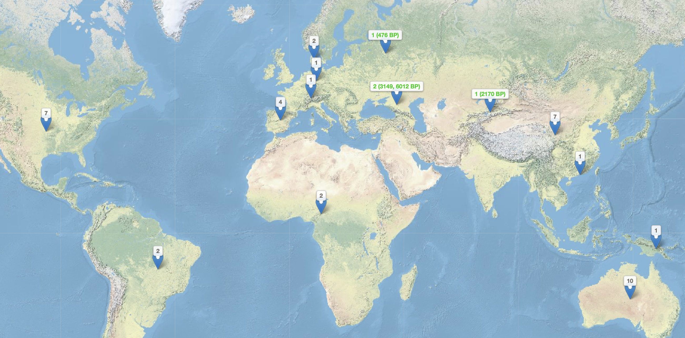
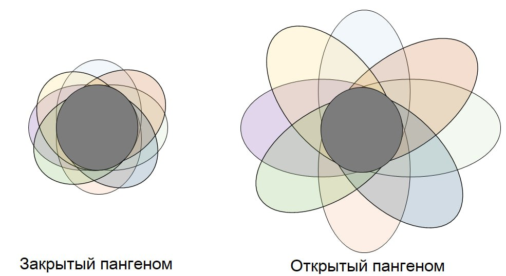
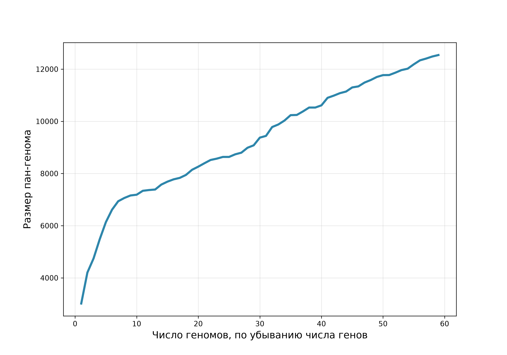
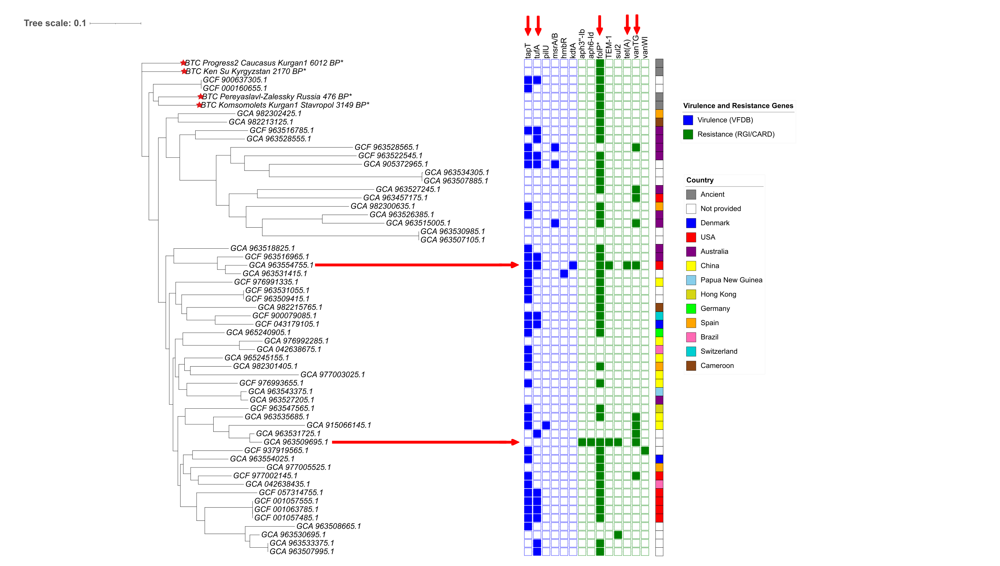
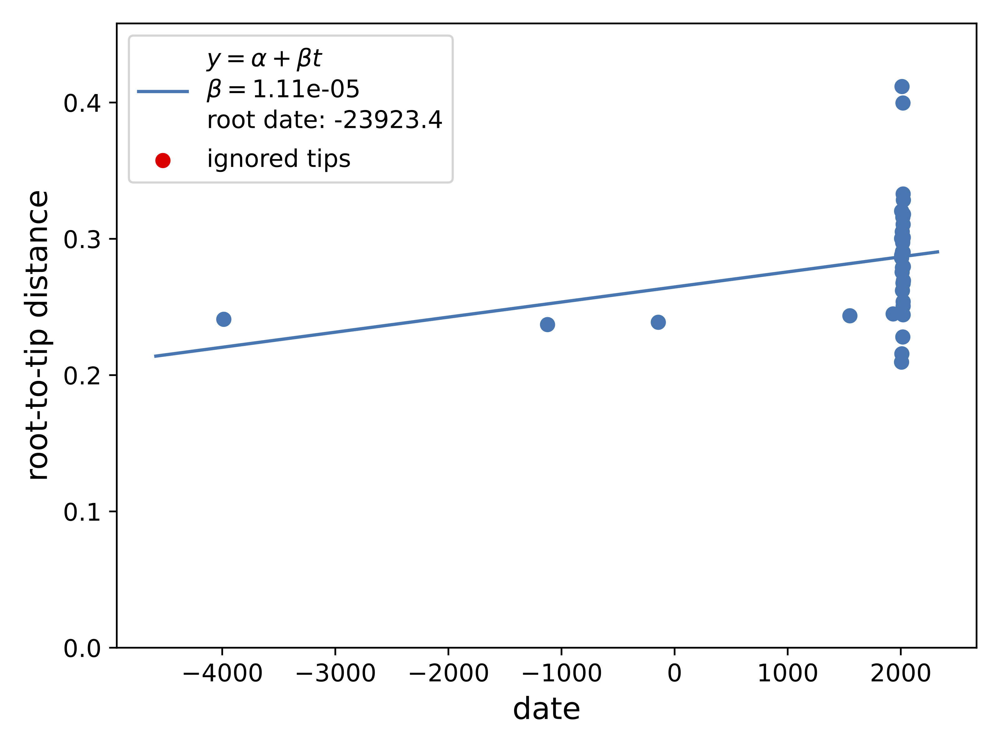
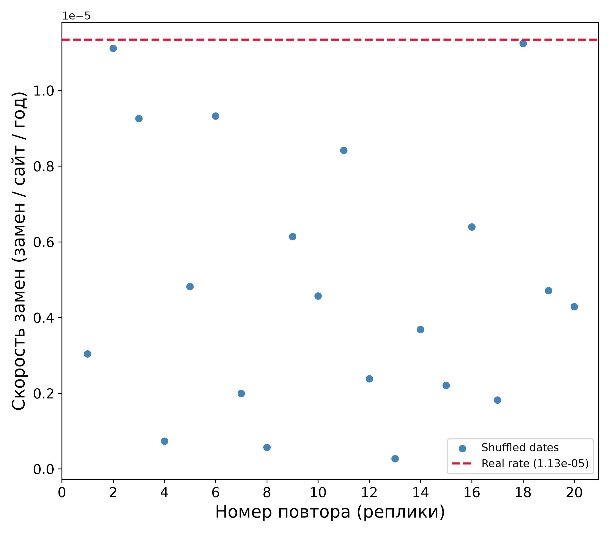

## Микроорганизмы группы HACEK

:::: {.columns}
::: {.column}

](results/figures/infekcionnyi-endokardit-bol.jpg)
:::
::: {.column}
- Грамотрицательные бактерии группы HACEK (*Haemophilus* spp., *Aggregatibacter actinomycetemcomitans*, *Cardiobacterium hominis*, *Eikenella corrodens* и *Kingella kingae*) входят в состав нормальной микрофлоры полости рта и верхних дыхательных путей человека.

- Основная опасность этих маловирулентных микроорганизмов — способность вызывать медленно текущий инфекционный эндокардит (ИЭ), часто на фоне уже повреждённых или протезированных клапанов сердца [@khaledi2022; @chambers2013].
:::
::::

## Актуальность

:::: {.columns}
::: {.column}
- **Затрудненная диагностика:** *C. hominis* обладает «крайне низкой вирулентностью» [@ellner1979], что маскирует болезнь. Стертое течение затягивает диагностику до **138 ± 128 дней** [@malani2006], приводя к тяжелой деструкции клапанов.
- **Факторы риска:** протезирование клапанов (57%), стоматологические вмешательства и кариес (20%) [@ono2023].
- **Эволюция резистентности:** появление β-лактамаз (типа TEM) уже вынудило сменить «золотой стандарт» терапии (ампициллин + гентамицин) на цефалоспорины III поколения [@lequellec1994a; @walkty2005b].
:::

::: {.column}
![Осложнения инфекционного эндокардита (поражение клапанов и электродов, системные эмболии, инфаркты органов, изменения кожи и глазного дна). Адаптировано из [@holland2016].](results/figures/holland2016_Fig4.png)
:::
::::
## Цель и задачи исследования

**Цель:** Оценить эволюционный потенциал патогенов группы HACEK на примере *Cardiobacterium hominis* — реконструировать структуру пан-генома, филогеографические связи и набор генов вирулентности и антибиотикорезистентности у современных и древних штаммов.

**Задачи:**

- **Пан-геномный анализ** современных (n = 55) и древних (n = 4, из зубного налёта археологических образцов) штаммов *C. hominis*.
- **ML-филогения** по коровому выравниванию:
  - проверка кластеризации образцов по странам;
  - поиск сигнала времени и, при его наличии, построение датированного дерева.
- **Анализ генов факторов вирулентности** (VFDB) **и генов антибиотикорезистентности** (CARD/RGI).

## Карта сбора образцов

{#fig-map}

## Кривая насыщаемости пан-генома *Cardiobacterium hominis*

::::: columns
::: column
{#fig-panexpl}
:::

::: column
{#fig-pancurve}
:::
:::::

## Филогенетический анализ и профиль вирулентности

{#fig-genes1}

## Сигнал времени

::::: columns

::: column
{#fig-regr}
:::

::: column
{#fig-drt}
:::
:::::

## Выводы

1.  Пан-геном *C. hominis* **открытый**, число коровых генов - 451

2.  При стандартном пороге **факторов вирулентности не выявлено**; древние образцы не несут ни одного гена факторов вирулентности даже при пороге 70%. Результат согласуется с классическими клиническими наблюдениями

3.  Картина резистентности мозаична: большинство сигналов — единичные, но выделяются GCA_963509695.1 (полирезистентность) и GCA_963554755.1 (*tet(A)*).

4.  ML-дерево **не подтверждает** пространственную структуру, сигнал времени в выборке отсутствует.

## Список литературы {shrink=5}

::: {#refs}
:::