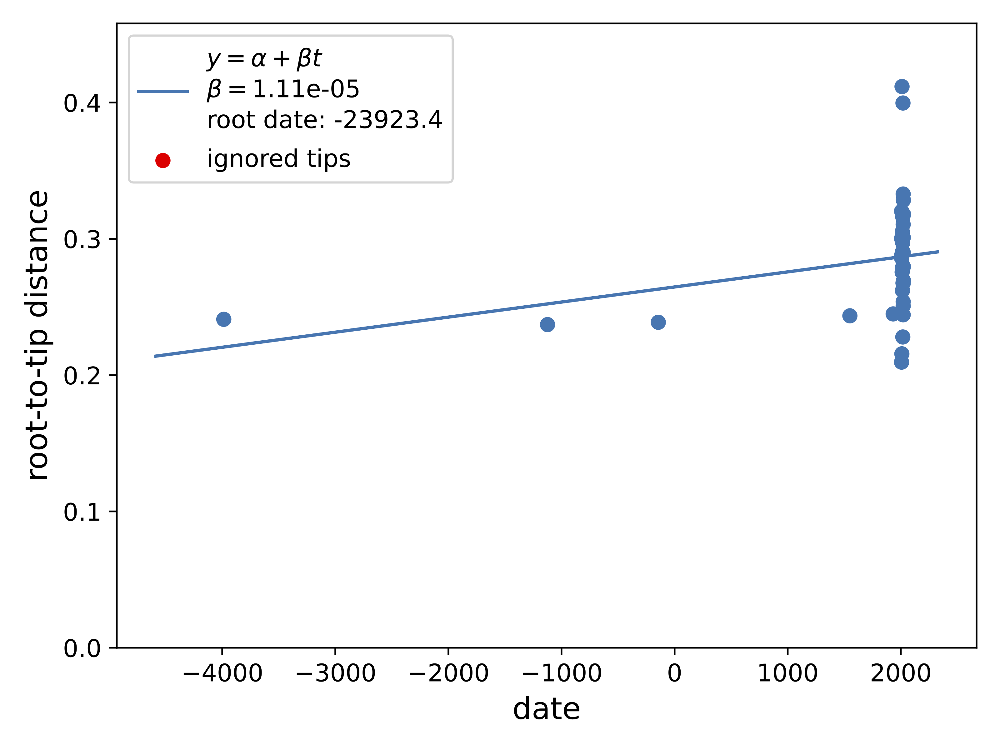

Датированное дерево имеет смысл только если расстояние от корня растёт с возрастом образца. 
TreeTime проверяет это регрессией по ML-дереву. 
Корень заново выбирается так, чтобы прямая легла лучше всего (`--reroot least-squares`).

Год сбора современных сборок берётся из метаданных. Диапазон вроде 1900/1965 заменяется серединой, полная дата переводится в долю года. Если поле даты пустое, образец в файл не попадает: 
TreeTime оценит год сам. 

Четыре древних возраста заданы отдельно. `4510` — середина интервала 1500–1600 н.э. `7130` — середина 1240–1007 до н.э. 
Для `3140` и `1780` год посчитан как 2026 минус возраст в л.н., а не как 1950 минус радиоуглеродный возраст.

| ID | Год в файле дат |
|---|---|
| 4510 | 1550 |
| 7130 | −1123,5 |
| 3140 | −3986 |
| 1780 | −144 |

Даты пишутся под именами из выравнивания и стыкуются с исходным деревом `C_H_ML_tree.treefile`, 
не с короткими именами для iTOL. Дата есть у 35 из 59 листов.

```{python}
#| code-fold: true
#| eval: false
import re, csv
from datetime import date
from Bio import SeqIO

fasta_path = '../data/C_H/all_core_alignment_no_outgroup_C_H/80_percent/clipkit_core_snps.fa'
meta_path  = '../data/C_H/assembly_metadata/Cardiobacterium_hominis.tsv'
out_csv    = '../data/C_H/all_core_alignment_no_outgroup_C_H/dates.csv'

MODERN_DATE = 2026

def parse_date(raw):
    raw = (raw or '').strip()
    if not raw or raw.lower() in ('not provided', 'na', 'nan', '-'):
        return None
    m = re.fullmatch(r'(\d{4})\s*[/\-]\s*(\d{4})', raw)          # 1900/1965
    if m: return (int(m.group(1)) + int(m.group(2))) / 2
    m = re.fullmatch(r'(\d{4})-(\d{2})-(\d{2})', raw)            # 2007-05-14
    if m:
        d = date(int(m.group(1)), int(m.group(2)), int(m.group(3)))
        return d.year + (d.timetuple().tm_yday - 1) / 365.25
    m = re.fullmatch(r'(\d{4})', raw)                            # 2021
    if m: return float(m.group(1))
    return None

# accession -> дата (или None)
meta = {}
with open(meta_path) as fh:
    for row in csv.DictReader(fh, delimiter='\t'):
        acc = (row.get('AssemblyAccession') or '').strip()
        if acc:
            meta[acc] = parse_date(row.get('Collection_date'))

# древние — вручную
ancient = {
    '000008104510': 1550.0,
    '000008107130': -1123.5,
    '000008103140': 2026 - 6012,
    '000008101780': 2026 - 2170,
}

with open(out_csv, 'w') as out:
    out.write('name,date\n')
    for rec in SeqIO.parse(fasta_path, 'fasta'):
        name = rec.id.split()[0]
        # 1) древние
        if any(k in name for k in ancient):
            d = next(v for k, v in ancient.items() if k in name)
        else:
            # 2) ищем accession из TSV как подстроку в имени
            d = None
            for acc, y in meta.items():
                if acc in name:
                    d = y
                    break
            # 3) если вообще нет в метаданных — современный
            if d is None and not any(acc in name for acc in meta):
                d = MODERN_DATE
        if d is None:
            continue          # дата неизвестна — TreeTime оценит сам
        out.write(f'{name},{d}\n')

print('wrote', out_csv)
```

```{bash}
#| eval: false
# pip install phylo-treetime
input_nwk='../data/C_H/old_iq_tree_no_outgroup/C_H_ML_tree.treefile'
input_fasta='../data/C_H/all_core_alignment_no_outgroup_C_H/80_percent/clipkit_core_snps.fa'
dates_csv='../data/C_H/all_core_alignment_no_outgroup_C_H/dates.csv'
treetime clock --tree $input_nwk --aln $input_fasta --dates $dates_csv --reroot least-squares --outdir ../data/C_H/all_core_alignment_no_outgroup_C_H/treetime_with_ancient
```



r² = 0,08. Временного сигнала нет, и датированное дерево по текущей выборке не строится.

Дальше штаммы сравниваются только по присутствию и отсутствию генов патогенности и антибиотикорезистентности.
