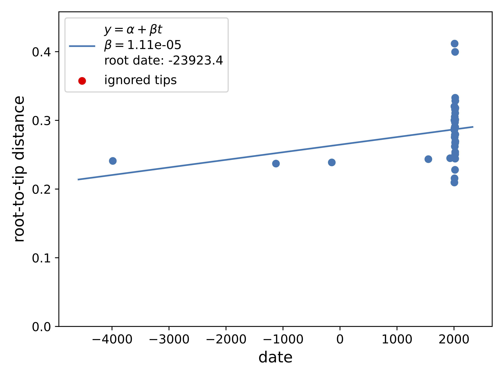

## Проверка временного сигнала (Root-to-tip регрессия)

Построение датированного филогенетического дерева имеет смысл только при наличии в данных **временного сигнала** — когда генетическое расстояние от корня дерева до листьев линейно растёт с возрастом образцов. Для проверки этой гипотезы мы использовали `TreeTime`, который строит линейную регрессию расстояний по дереву максимального правдоподобия (ML) и автоматически подбирает положение корня так, чтобы минимизировать остатки (`--reroot least-squares`).

### Подготовка дат сбора образцов

В итоговый файл с датами вошли **35 из 59 образцов**. Имена последовательностей приведены в соответствие с исходным выравниванием и деревом `C_H_ML_tree.treefile` (без сокращений, использованных ранее для визуализации в iTOL).

Даты формировались по следующим правилам:

* **Современные сборки:** год взят из метаданных. Интервалы (например, `1900/1965`) заменены на середину диапазона, а точные даты переведены в десятичную долю года. Образцы без указанной даты в файл не включались
* **Древние образцы:** для четырёх палеогеномов возраст задан вручную. Для образцов `4510` (1500–1600 гг. н.э.) и `7130` (1240–1007 гг. до н.э.) использована середина калиброванного интервала. Для образцов `3140` и `1780` календарный год рассчитан от текущего года ($2026 - \text{возраст в л.н.}$), а не от стандартного радиоуглеродного нуля (1950 г.).

| ID образца | Возраст / интервал | Год в файле дат |
| :--- | :--- | :--- |
| `4510` | 1500–1600 гг. н.э. | `1550` |
| `7130` | 1240–1007 гг. до н.э. | `−1123.5` |
| `3140` | 6012 л.н. | `−3986` |
| `1780` | 2170 л.н. | `−144` |

```{python}
#| code-fold: true
#| eval: false
import re, csv
from datetime import date
from Bio import SeqIO

fasta_path = '../data/C_H/all_core_alignment_no_outgroup_C_H/80_percent/clipkit_core_snps.fa'
meta_path  = '../data/C_H/assembly_metadata/Cardiobacterium_hominis.tsv'
out_csv    = '../data/C_H/all_core_alignment_no_outgroup_C_H/dates.csv'

MODERN_DATE = 2026

def parse_date(raw):
    raw = (raw or '').strip()
    if not raw or raw.lower() in ('not provided', 'na', 'nan', '-'):
        return None
    m = re.fullmatch(r'(\d{4})\s*[/\-]\s*(\d{4})', raw)          # 1900/1965
    if m: return (int(m.group(1)) + int(m.group(2))) / 2
    m = re.fullmatch(r'(\d{4})-(\d{2})-(\d{2})', raw)            # 2007-05-14
    if m:
        d = date(int(m.group(1)), int(m.group(2)), int(m.group(3)))
        return d.year + (d.timetuple().tm_yday - 1) / 365.25
    m = re.fullmatch(r'(\d{4})', raw)                            # 2021
    if m: return float(m.group(1))
    return None

# accession -> дата (или None)
meta = {}
with open(meta_path) as fh:
    for row in csv.DictReader(fh, delimiter='\t'):
        acc = (row.get('AssemblyAccession') or '').strip()
        if acc:
            meta[acc] = parse_date(row.get('Collection_date'))

# древние — вручную
ancient = {
    '000008104510': 1550.0,
    '000008107130': -1123.5,
    '000008103140': 2026 - 6012,
    '000008101780': 2026 - 2170,
}

with open(out_csv, 'w') as out:
    out.write('name,date\n')
    for rec in SeqIO.parse(fasta_path, 'fasta'):
        name = rec.id.split()[0]
        # 1) древние
        if any(k in name for k in ancient):
            d = next(v for k, v in ancient.items() if k in name)
        else:
            # 2) ищем accession из TSV как подстроку в имени
            d = None
            for acc, y in meta.items():
                if acc in name:
                    d = y
                    break
            # 3) если вообще нет в метаданных — современный
            if d is None and not any(acc in name for acc in meta):
                d = MODERN_DATE
        if d is None:
            continue          # дата неизвестна — TreeTime оценит сам
        out.write(f'{name},{d}\n')

print('wrote', out_csv)
```

### Запуск регрессионного анализа

```{bash}
#| eval: false
# pip install phylo-treetime
input_nwk='../data/C_H/old_iq_tree_no_outgroup/C_H_ML_tree.treefile'
input_fasta='../data/C_H/all_core_alignment_no_outgroup_C_H/80_percent/clipkit_core_snps.fa'
dates_csv='../data/C_H/all_core_alignment_no_outgroup_C_H/dates.csv'
treetime clock --tree $input_nwk --aln $input_fasta --dates $dates_csv --reroot least-squares --outdir ../data/C_H/all_core_alignment_no_outgroup_C_H/treetime_with_ancient
```

Сохраняем в папку резульатов и переводим в png формат



Коэффициент детерминации составил **$R^2 = 0{,}08$**, а линия регрессии проходит почти горизонтально. Это говорит об отсутствии выраженного временного сигнала в текущей выборке.

---

## Тест рандомизации дат (Date Randomization Test, DRT)

Чтобы убедиться, что слабый сигнал не является случайным артефактом, мы дополнительно провели **тест рандомизации дат (DRT)**. В ходе этого теста даты сбора случайно перемешиваются между последовательностями, что разрушает реальную связь между временем и накоплением мутаций. Если в данных есть истинный молекулярный ход часов, скорость эволюции на реальных датах должна заметно превышать оценки, полученные на перемешанных выборках.

Мы запустили `TreeTime` на исходных данных и на **20 случайных перестановках** (поскольку `TreeTime` возвращает точечную оценку скорости без доверительного интервала, сравнение проводится по распределению точечных оценок).


```{bash}
#| eval: false
input_nwk='../data/C_H/old_iq_tree_no_outgroup/C_H_ML_tree.treefile'
input_fasta='../data/C_H/all_core_alignment_no_outgroup_C_H/80_percent/clipkit_core_snps.fa'
dates_csv='../data/C_H/all_core_alignment_no_outgroup_C_H/dates.csv'
outdir='../data/C_H/all_core_alignment_no_outgroup_C_H/treetime_drt'

python ../scripts/run_treetime_drt.py \
    --tree $input_nwk \
    --aln $input_fasta \
    --dates $dates_csv \
    --outdir $outdir \
    --reps 20

```

```cp data/C_H/all_core_alignment_no_outgroup_C_H/treetime_drt/drt_plot.png results/figures```


Хотя скорость замещения на исходных данных (красная пунктирная линия) в среднем выше, чем на перемешанных выборках (синие точки), две случайные реплики показали значения скорости и $R^2$, сопоставимые с реальными данными. Качество линейной подгонки на исходных датах оказалось не выше случайного шума.

## Вывод

Оба метода подтвердили, что **в текущей выборке отсутствует достоверный временной сигнал**, поэтому построение калиброванного по времени дерева невозможно. В дальнейшей работе мы отказались от молекулярного датирования и перешли к сравнительному анализу штаммов по наличию и отсутствию генов патогенности и антибиотикорезистентности.

