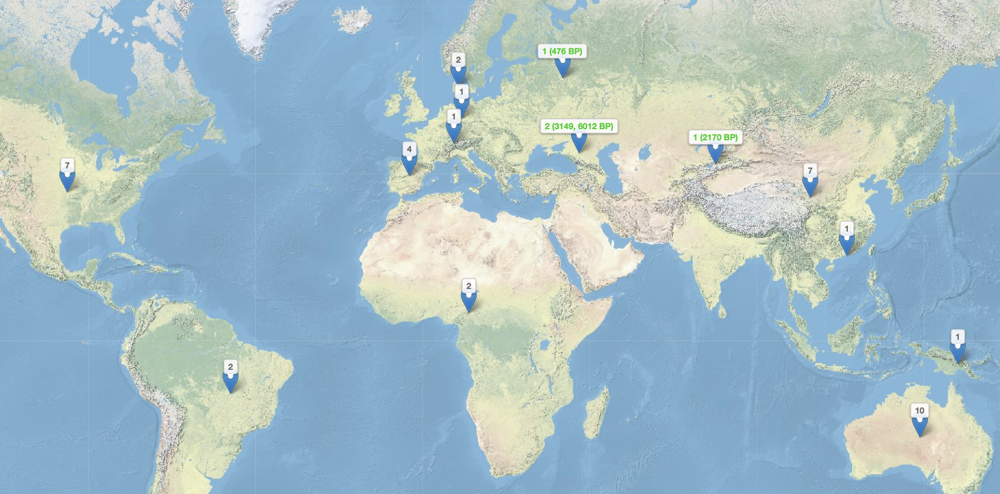
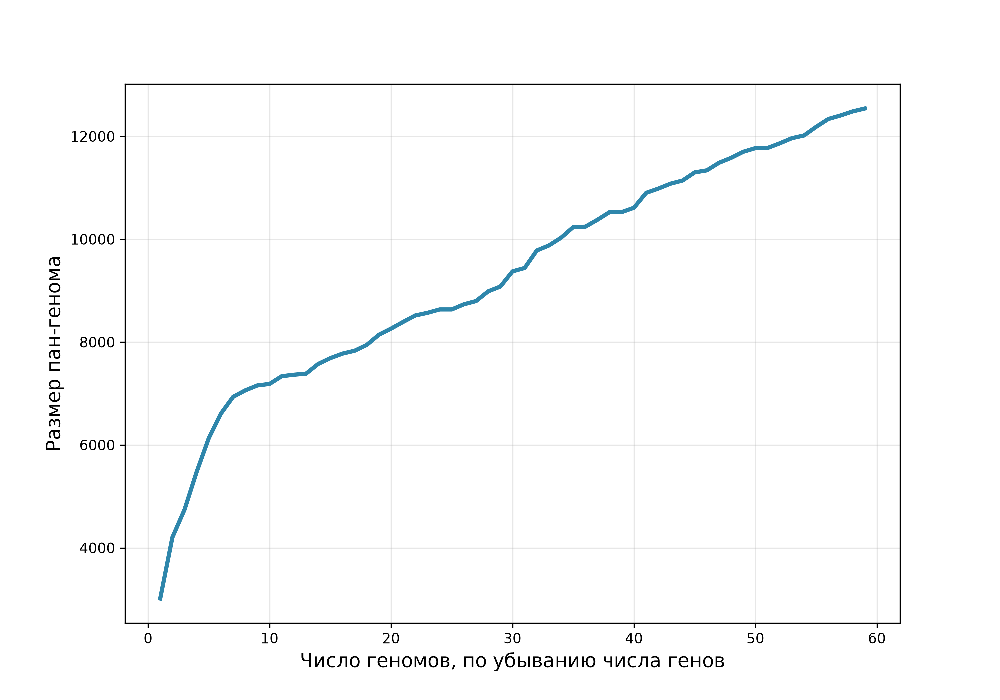
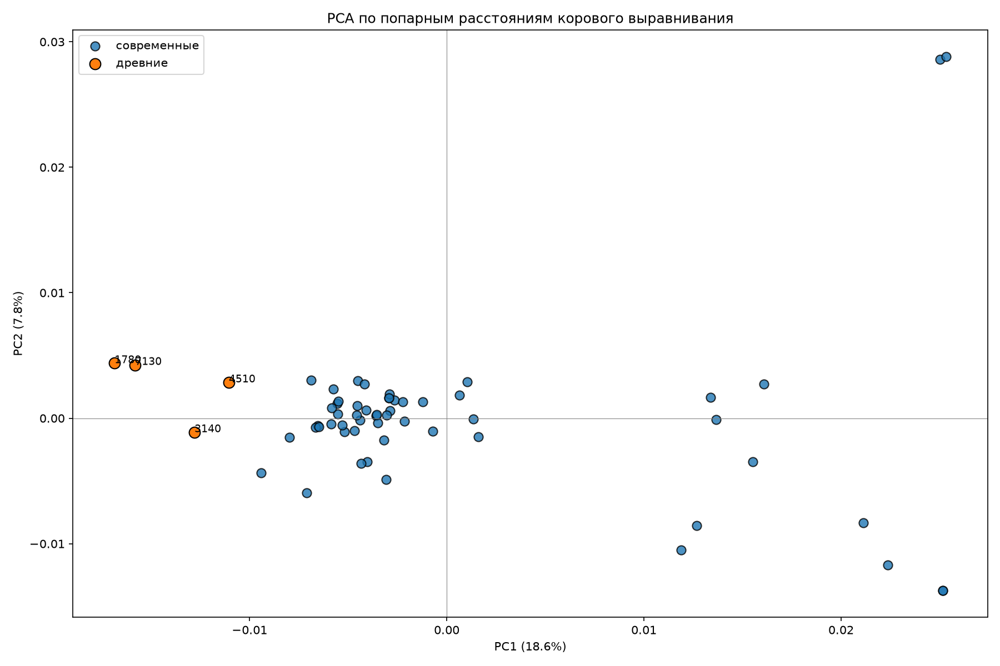
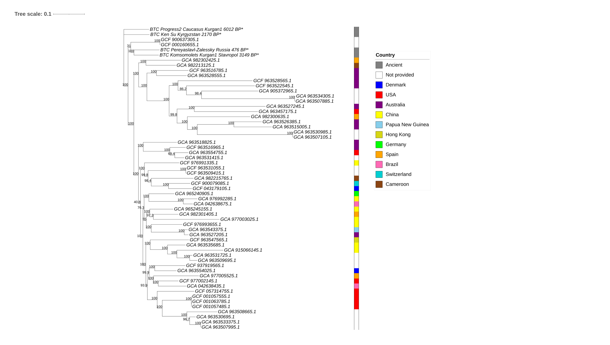
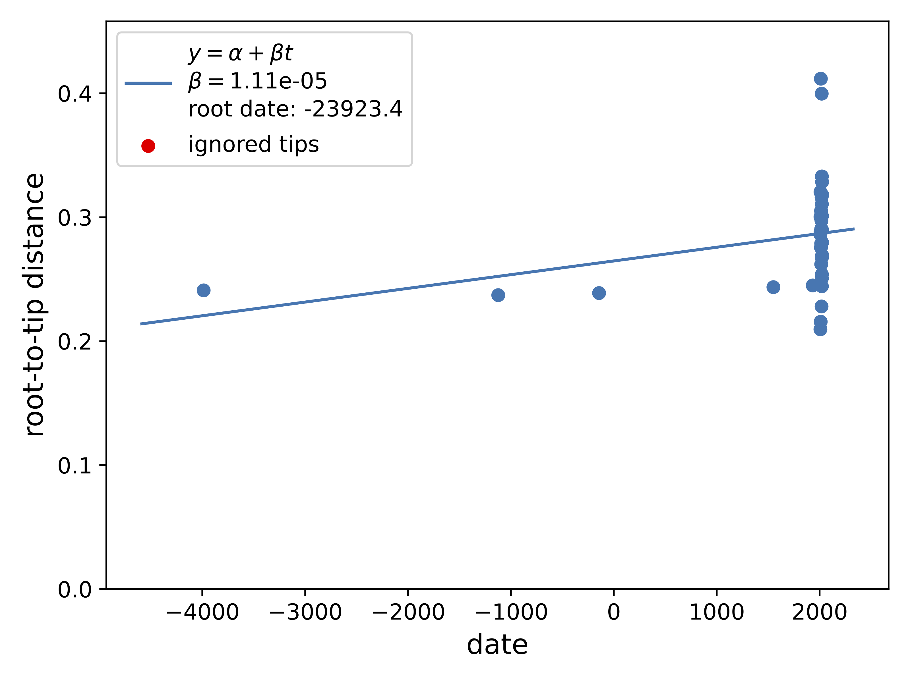
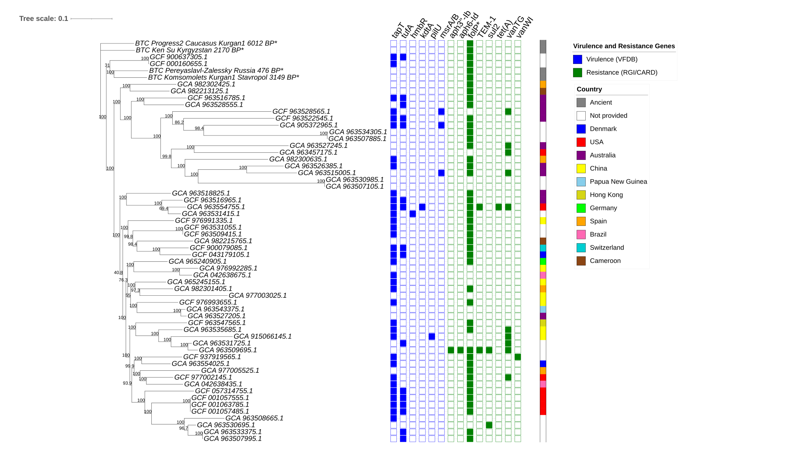

# Магистерский диплом 2027

Сравнительный геномный анализ древних и современных штаммов *C. hominis*. 
Метаданные *Eikenella corrodens* и *Aggregatibacter actinomycetemcomitans* скачиваются в той же главе, но до дерева и генов эти два вида здесь не доведены. 
Рекомбинация и положительный отбор в текущие главы не входят.

По *C. hominis* в книге сделано следующее:

- собраны метаданные и сборки, для древних образцов построены консенсусы;
- по 59 геномам посчитан пан-геном и ML-дерево;
- проверен сигнал времени;
- отмечены гены вирулентности (VFDB) и устойчивости (CARD/RGI).

## Введение

Инфекционный эндокардит (ИЭ) остается тяжелым заболеванием с высокой летальностью, несмотря на значительный прогресс в его диагностике и терапии [@tharsiga2026]. Среди редких возбудителей ИЭ особое место занимают грамотрицательные бактерии группы HACEK (*Haemophilus*, *Aggregatibacter actinomycetemcomitans*, *Cardiobacterium hominis*, *Eikenella corrodens* и *Kingella kingae*), входящие в состав нормальной микрофлоры полости рта и верхних дыхательных путей человека [@khaledi2022; @chambers2013].

*Cardiobacterium hominis* известен как возбудитель инфекционного эндокардита с 1962 года [@lequellec1994]. Согласно классическим данным Ellner et al., этот микроорганизм обладает «крайне низкой вирулентностью» [@ellner1979].

Несмотря на это, он способен вызывать тяжелое поражение эндокарда при наличии фоновой патологии. Как показал недавний обзор 44 клинических случаев, основными предрасполагающими факторами развития инфекции выступают перенесенное протезирование клапанов (57%), стоматологические вмешательства или кариес (20%), а также врожденные аномалии клапанного аппарата (5%) [@ono2023].

Исторически заболевание ассоциировалось с неблагоприятным прогнозом: в когорте Ellner et al. (до широкого применения эффективной антибактериальной терапии и хирургии клапанов) летальность достигала 26% [@ellner1979]. Однако внедрение эффективных протоколов лечения кардинально изменило ситуацию: по данным Malani et al. (61 случай), частота выздоровления при поражении ествественных клапанов составила 93%, а при протезном эндокардите — 94%. При этом потребность в замене клапана достигала 45% (27 из 61 случаев) [@malani2006].

При этом за последние десятилетия существенно изменился возрастной портрет пациента: пик заболеваемости сместился с 45 лет в 1950-х годах до 70 лет в настоящее время, а пожилые люди имеют пятикратно повышенный риск развития ИЭ по сравнению с общей взрослой популяцией [@ursi2018].

### Клинические особенности и диагностика

Для эндокардита, вызванного *C. hominis*, характерно подострое, медленное и малосимптомное развитие. Длительность симптомов до диагноза: в среднем 138 ± 128 дней [@malani2006].

Диагностика базируется на сочетании трех ключевых критериев: эхокардиографического исследования, верификации клинических признаков (лихорадка, появление сердечных шумов) и микробиологического выделения возбудителя, часто на фоне заболеваний пародонта или бактериемии [@khaledi2022].

![Диагностика ИЭ [@khaledi2022]](results/figures/HACEK.png){#fig-HACEK}

### Эволюция подходов к антибактериальной терапии и профили резистентности

При выборе тактики лечения клиницисты опираются на актуальные национальные и международные стандарты [@kotova2024].

- **Российские клинические рекомендации**: «Инфекционный эндокардит и инфекция внутрисердечных устройств» (2021 г.).

- **Европейские рекомендации**: «ESC Guidelines for the management of endocarditis» (2023 г.)

Исторически «золотым стандартом» терапии эндокардита, вызванного бактериями группы HACEK, считалась комбинация ампициллина и гентамицина [@calza2004]. Однако появление штаммов *C. hominis*, продуцирующих β-лактамазы (в частности, типа TEM), потребовало пересмотра этих схем [@lequellec1994a; @lu2000a]. С середины 2000-х годов препаратами выбора стали цефалоспорины III поколения (преимущественно цефтриаксон): рекомендуемая длительность курса составляет 4 недели при эндокардите естественного клапана и 6 недель — при поражении протеза [@walkty2005b]. Актуальность этого подхода подтверждается и современными клиническими наблюдениями: например, в описанном в 2026 году случае эндокардита у 40-летнего пациента без сопутствующей патологии шестинедельный курс цефалоспорина III поколения привел к полному выздоровлению [@tharsiga2026].

Помимо β-лактамов, в контексте эволюции и эпидемиологии резистентности *C. hominis* представляют интерес и другие классы антибиотиков, даже если они не входят в первую линию терапии:

- Гликопептиды (ванкомицин): преимущественно применяются против грамположительных кокков и часто назначаются эмпирически до подтверждения возбудителя. Однако еще в 1979 году был описан клинический изолят *C. hominis*, устойчивый к ванкомицину (МПК 25 мкг/мл) и эритромицину [@ellner1979].
- Тетрациклины и сульфаниламиды: не используются в качестве стандартной терапии ИЭ, вызванного HACEK, однако их гены устойчивости широко распространены в микробных сообществах полости рта и служат важными маркерами горизонтального переноса генов.

Учитывая редкость выделения *C. hominis* в рутинной практике, его геномная структура, эволюционная динамика и скрытый потенциал генов устойчивости остаются недостаточно изученными. Целью данного исследования стал сравнительный геномный анализ современных и древних штаммов *C. hominis* для оценки структуры их пан-генома, филогеографических связей, а также набора факторов вирулентности и механизмов антибиотикорезистентности.

## Данные

В NCBI 55 современных сборок *C. hominis* из 11 стран. У 17 страна не указана. Списки accession лежат в [главе про метаданные](chapters/download_assemblies.qmd).

| Страна | Сборок |
|---|---|
| Страна не указана | 17 |
| Австралия | 10 |
| Китай | 7 |
| США | 7 |
| Испания | 4 |
| Бразилия | 2 |
| Камерун | 2 |
| Дания | 2 |
| Германия | 1 |
| Гонконг | 1 |
| Папуа — Новая Гвинея | 1 |
| Швейцария | 1 |

Древних образцов четыре. На карте Комсомолец и Прогресс 2 стоят на одной точке, поэтому древних мест три, а образцов четыре.

| Образец | Возраст | Место |
|---|---|---|
| 4510 | 476 л.н. (1500–1600 н.э.) | Переславль-Залесский, Россия |
| 7130 | 3149 л.н. (1240–1007 до н.э.) | Курган Комсомолец 1, Ставропольский край |
| 3140 | 6012 ± 28 л.н. | Прогресс 2, курган 1, Кавказ |
| 1780 | 2170 ± 23 л.н. | Кен-Су, Киргизия |

## Как устроен анализ

Древние консенсусы построены по BAM, уже выровненным на референс *C. hominis* NCTC10426 (`GCF_900637305.1`). 
ANGSD (`-doFasta 1`) пишет в позицию случайную букву среди оснований с качеством картирования и качеством основания не ниже 20. 
Порог глубины не задан. Где ридов нет, стоит N. Подробности в [главе про консенсусы](chapters/create_consensus.qmd).

Современные сборки без готового GFF и четыре консенсуса аннотированы Prokka (`--kingdom Bacteria`). 
В Roary идут только эти GFF: файлы NCBI ему не подходят. См. [аннотацию](chapters/annotate_assemblies.qmd).

Roary кластеризует белки при идентичности 80% (`-i 80`) и считает коровым ген, который есть минимум у 80% штаммов (`-cd 80`). 
Получилось 451 коровых генов из 12 541. См. [пан-геном](chapters/make_core_alignment.qmd).

В коровом выравнивании 343 520 сайта и ни одной колонки без пропуска, поэтому `snp-sites -c` пуст. 
В дерево взят файл ClipKIT `kpi-smart-gap`: 39 954 информативных сайта. См. [отбор сайтов](chapters/find_snp.qmd).

IQ-TREE: `GTR+F+ASC+G4`, 1000 ультрабыстрых бутстрепов и 1000 SH-aLRT, без аутгруппы. 
Поправка `+ASC` стоит потому, что константных сайтов в выравнивании нет. См. [ML-дерево](chapters/ML_tree.qmd).

Сигнал времени проверяет TreeTime (`--reroot least-squares`). Дата известна у 35 из 59 листьев. См. [сигнал времени](chapters/check_time_signal.qmd).

Гены вирулентности ищет ABRicate по VFDB, гены устойчивости — RGI по CARD, только попадания Perfect и Strict. См. [главу про гены](chapters/analyse_genes.qmd).

## Результаты

### Пан-геном

Коровых генов 451 из 12 541. Пан-геном открытый.

### ML-дерево

### Сигнал времени

r² = 0,08. Датированное дерево по этой выборке не строится. Дальше штаммы сравниваются по присутствию и отсутствию генов патогенности и антибиотикорезистентности.

### Гены вирулентности

При обычном пороге ABRicate VFDB не находит ничего. 
При 70% идентичности и 70% покрытия находятся шесть гомологов: *tapT* (34 образца), *tufA* (16), *msrA/B* (3), *hmbR*, *kdtA/waaA* и *pilU* (по одному). 
Это гены адгезии, стресса и оболочки, не токсины. У древних консенсусов нет ни одного из них. 
Так результат стыкуется с описанием «крайне низкой вирулентности» вида [@ellner1979].

### Гены устойчивости

RGI (CARD, Perfect и Strict) находит восемь генов разных классов:

- сульфаниламиды: *folP* с заменами у 45 образцов, в том числе у всех четырёх древних; и *sul2* у двух современных образцов;
- гликопептиды: *vanT* кластера vanG у 10 образцов и *vanW* кластера vanI у одного;
- β-лактамы: *TEM-1* у двух;
- аминогликозиды: *APH(3'')-Ib* и *APH(6)-Id* у одного;
- тетрациклины: *tet(A)* у одного.

У `GCA_963509695.1` сразу четыре класса: аминогликозиды, *TEM-1*, сульфаниламиды и *vanT*. У `GCA_963554755.1` есть *tet(A)*.

*vanT* кодирует серин-рацемазу и сам по себе не означает устойчивость к ванкомицину: для кластера нужны и остальные компоненты, включая VanG и VanXY. 

Ванкомицин и тетрациклин не входят в первую линию терапии *C. hominis*, так что эти находки не меняют клинические рекомендации. Они описывают, какие гены устойчивости у вида уже есть.

### Сводка

Пан-геном *C. hominis* открытый: 451 коровый ген из 12 541. 
Древние образцы смещены относительно современных и на PCA, и на ML-дереве. Временного сигнала нет, r² = 0,08.

При стандартном пороге факторов вирулентности нет. При пороге 70% шесть гомологов находятся только у современных сборок. 
Картина устойчивости мозаичная. Общий для древних образцов сигнал — *folP*. 
Отдельно выделяются `GCA_963509695.1` и `GCA_963554755.1`.
