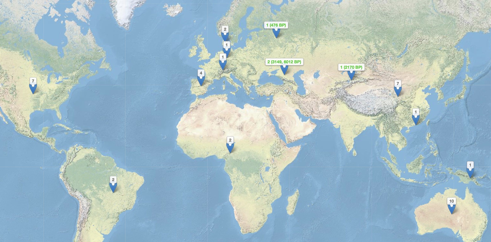
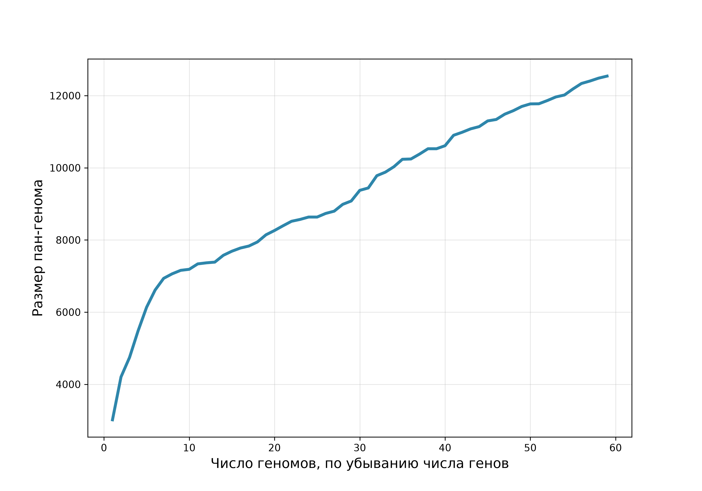
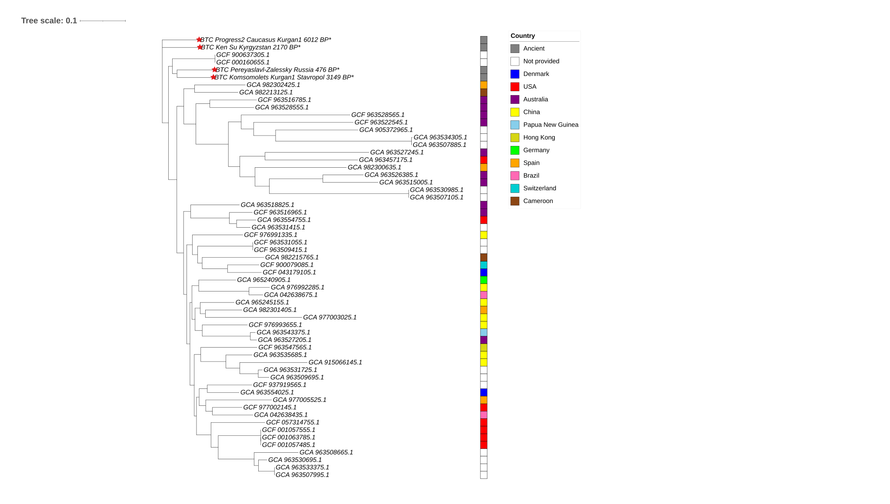
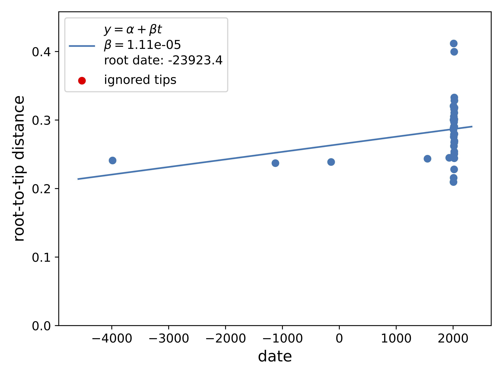
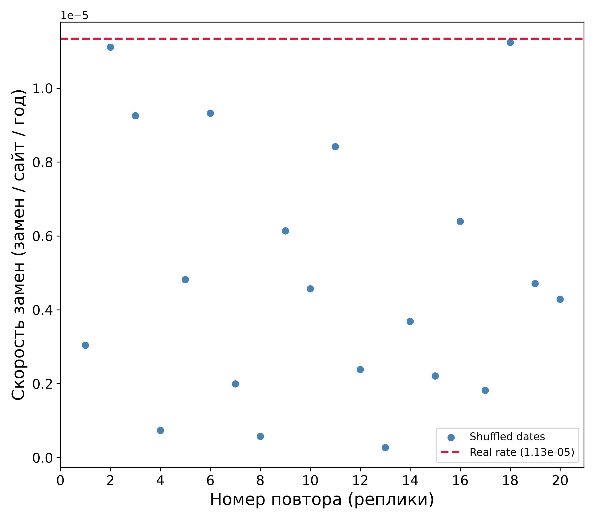
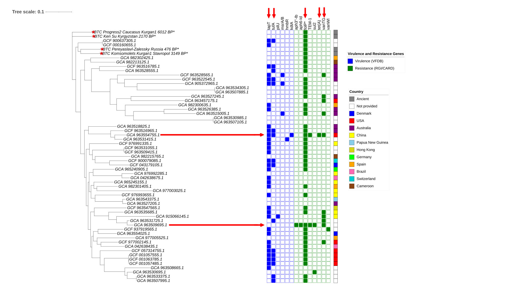

# Магистерский диплом 2027

Сравнительный геномный анализ древних и современных штаммов группы HACEK.

**Цель работы** — сравнительный геномный анализ древних и современных штаммов трёх видов группы HACEK (*Cardiobacterium hominis*, *Eikenella corrodens*, *Aggregatibacter actinomycetemcomitans*) для оценки их филогенетических связей, наличия временного сигнала и набора генов факторов вирулентности и антибиотикорезистентности.

**Задачи:**

- Построить ML-филогенетическое дерево по коровому выравниванию для *C. hominis*, *E. corrodens* и *A. actinomycetemcomitans*.
- Проверить наличие сигнала времени в выборке и, при его наличии, построить датированное дерево.
- Выявить гены факторов вирулентности (VFDB) и гены антибиотикорезистентности (CARD/RGI) у исследованных штаммов.
- (Опционально) Провести анализ де-ново сборок, включая изучение рекомбинации и признаков положительного отбора.

В настоящей главе представлены результаты по *C. hominis*. Анализ *E. corrodens* и *A. actinomycetemcomitans* запланирован как продолжение работы.

## Введение

](results/figures/infekcionnyi-endokardit-bol.jpg)

Инфекционный эндокардит (ИЭ) — это воспаление внутренней оболочки сердца (эндокарда), чаще всего поражающее сердечные клапаны. ИЭ остается тяжелым жизнеугрожающим заболеванием с высокой летальностью, несмотря на значительный прогресс в диагностике и антибактериальной терапии [@tharsiga2026]. Ситуация усугубляется изменением демографического профиля пациентов: за последние десятилетия пик заболеваемости сместился с 45 лет в 1950-х годах до 70 лет в настоящее время - риск развития ИЭ у пожилых людей в пять раз выше, чем в общей взрослой популяции [@ursi2018].

Среди редких возбудителей ИЭ особое место занимают грамотрицательные бактерии группы HACEK (*Haemophilus*, *Aggregatibacter actinomycetemcomitans*, *Cardiobacterium hominis*, *Eikenella corrodens* и *Kingella kingae*), входящие в состав нормальной микрофлоры полости рта и верхних дыхательных путей человека [@khaledi2022; @chambers2013]. *Cardiobacterium hominis* известен как возбудитель эндокардита с 1962 года [@lequellec1994]. Согласно классическим представлениям Ellner et al., этот микроорганизм обладает «крайне низкой вирулентностью» [@ellner1979]. Однако в клинической практике эта особенность существенно затрудняет диагностику: низкая вирулентность не делает инфекцию безопасной, а лишь маскирует ее развитие, позволяя патогену длительно и незаметно разрушать ткани сердца при наличии фоновой патологии. Как показал обзор 44 клинических случаев, ключевыми факторами риска выступают перенесенное протезирование клапанов (57%), стоматологические вмешательства или кариес (20%), а также врожденные аномалии клапанного аппарата (5%) [@ono2023].

Исторически эндокардит, вызванный *C. hominis*, ассоциировался с высокой летальностью, достигавшей в доантибиотическую и раннюю хирургическую эпоху 26% [@ellner1979]. Внедрение современных протоколов лечения позволило повысить частоту выздоровления до 93% при поражении естественных клапанов и до 94% — при протезном эндокардите [@malani2006].

## Патогенез ИЭ и клинические особенности течения

![Этапы патогенеза инфекционного эндокардита - от повреждения эндотелия и адгезии бактерий до формирования вегетаций и системной эмболизации. Адаптировано из [@holland2016]](results/figures/holland2016_Fig2.png)

Развитие инфекционного эндокардита начинается с кратковременного попадания бактерий в кровь при стоматологических вмешательствах, наличии хронических очагов инфекции в полости рта или использовании внутривенных катетеров. Переносясь с кровотоком, микроорганизмы прикрепляются к поврежденным участкам внутренней выстилки сердца — на естественных или искусственных клапанах, а также на внутрисердечных устройствах. На примере *Staphylococcus aureus* показано, что возбудители способны активно проникать в клетки внутренней оболочки и вызывать их быстрое разрушение. По мере размножения колонии микробов погружаются в защитную основу из фибрина и тромбоцитов, образуя крупные инфицированные разрастания — так называемые вегетации [@holland2016].

![Органные проявления и осложнения инфекционного эндокардита (поражение клапанов и электродов, системные эмболии, инфаркты органов, изменения кожи и глазного дна). Адаптировано из [@holland2016].](results/figures/holland2016_Fig4.png)

Длительный рост вегетаций приводит к местному разрушению тканей вплоть до перфорации створок клапана (f–h). На поздних этапах частицы вегетаций могут крошиться, отрываться и переноситься током крови, вызывая закупорку питающих артерий жизненно важных органов с развитием инфарктов, инсультов и гнойных очагов. При правостороннем поражении сердца в первую очередь страдают легкие (c). При левостороннем процессе развиваются ишемические и геморрагические поражения головного мозга с образованием гнойников (b), инфаркты почек и селезенки (d), а также омертвение тканей конечностей (e). Дополнительно циркулирующие в крови иммунные комплексы вызывают распространенное воспаление мелких сосудов, которое проявляется, в частности, кровоизлияниями на глазном дне — пятнами Рота (a) [@holland2016].

![Диагностика ИЭ [@khaledi2022]](results/figures/HACEK.png)

Прямым следствием низкой вирулентности *C. hominis* является подострое, стертое и малосимптомное течение болезни. Из-за отсутствия яркой острой клиники период от появления первых признаков до постановки диагноза затягивается в среднем до 138 ± 128 дней [@malani2006]. В клинической картине преобладают неспецифические симптомы: лихорадка (74%), общая слабость и недомогание (53%), снижение массы тела и анорексия (40%), ночная потливость (24%), а также артралгии и миалгии (21%) [@malani2006]. В связи с этим диагностика требует комплексного подхода и опирается на сочетание эхокардиографии, оценки клинических признаков (лихорадка, появление новых сердечных шумов) и выделения возбудителя заболеваний пародонта или бактериемии [@khaledi2022].

Так, например, в недавнем клиническом наблюдении описан случай инфекционного эндокардита (ИЭ), вызванного *C. hominis*, у 37-летней женщины с двустворчатым аортальным клапаном и его протезом в анамнезе. Заболевание протекало подостро: в течение 3 месяцев пациентку беспокоила лишь нарастающая одышка. Длительное малосимптомное течение привело к развитию тяжелого осложнения — абсцесса корня аорты. В результате пациентке потребовалось повторное хирургическое вмешательство (замена протеза клапана и реконструкция корня аорты), после которого наступило выздоровление [@shah2024].

Другой пример поздней диагностики и ее последствий представлен в [@sundin2025], где описан случай протезного эндокардита митрального клапана у 67-летнего мужчины с биопротезом в анамнезе. Инфицирование *C. hominis* произошло после стоматологических процедур, проведенных без антибиотикопрофилактики. На протяжении 6 месяцев у пациента отмечались неспецифические и постепенно нарастающие симптомы: слабость, утомляемость, озноб, отеки нижних конечностей и периодическая лихорадка до 39,4 °C. Поводом для госпитализации послужили лишь положительные результаты амбулаторных посевов крови. Из-за трудностей культивирования *C. hominis* на стандартных питательных средах верификация диагноза затянулась, что привело к серьезным осложнениям: септическим эмболиям с развитием инфарктов селезенки и выраженной анемии (снижение гемоглобина с 13,6 до 9,1 г/дл). Пациенту была проведена повторная замена митрального клапана в сочетании с 6-недельным курсом внутривенной терапии цефтриаксоном; на контрольном осмотре через 6 недель зафиксировано полное разрешение симптомов.

## Эволюция подходов к антибактериальной терапии и профили резистентности

При выборе тактики лечения клиницисты руководствуются актуальными национальными и международными стандартами [@kotova2024]:

- Российские клинические рекомендации: «Инфекционный эндокардит и инфекция внутрисердечных устройств» (2021 г.);
- Европейские рекомендации: «ESC Guidelines for the management of endocarditis» (2023 г.).

Исторически «золотым стандартом» терапии эндокардита группы HACEK считалась комбинация ампициллина и гентамицина [@calza2004]. Однако распространение штаммов *C. hominis*, продуцирующих β-лактамазы (в частности, типа TEM), потребовало пересмотра этих схем [@lequellec1994a; @lu2000a]. С середины 2000-х годов препаратами выбора стали цефалоспорины III поколения (преимущественно цефтриаксон) длительностью 4 недели при поражении естественного клапана и 6 недель — при протезном эндокардите [@walkty2005b]. Эффективность такого подхода подтверждается и современными наблюдениями: так, в описанном в 2026 году случае эндокардита у 40-летнего пациента без сопутствующей патологии шестинедельный курс цефалоспорина III поколения привел к полному выздоровлению [@tharsiga2026].

*C. hominis* входит в состав орального микробиома, для которого характерен активнвый горизонтальный переносом генов. В связи с этим практический и научный интерес представляет мониторинг его резистентности к препаратам, не относящимся к первой линии терапии инфекционного эндокардита (ИЭ):

- Гликопептиды (ванкомицин): часто используются для эмпирической стартовой терапии ИЭ до выделения возбудителя. Как и другие грамотрицательные микроорганизмы, *C. hominis* обладает природной устойчивостью к ванкомицину из-за непроницаемости внешней мембраны для его крупных молекул.
- Тетрациклины и сульфаниламиды: не используются при эндокардитах, вызванных бактериями группы HACEK. Тем не менее vониторинг таких генов позволяет оценить эволюционный потенциал патогена и интенсивность межвидового генетического обмена.

## Эволюционная история орального микробиома

Реконструкция эволюционной истории микроорганизмов, ассоциированных с человеком, стала возможной благодаря развитию палеомикробиологии — направления, изучающего древнюю бактериальную ДНК (aDNA). Пионерские работы середины 1980-х годов доказали принципиальную возможность секвенирования древнего генетического материала, что открыло новые пути для изучения прошлого человека и его симбионтов. Как отмечается в обзорной работе Arning и Wilson (2020), одним из наиболее информативных источников древней бактериальной ДНК является зубной камень (dental calculus), позволяющий реконструировать состав древнего орального микробиома и выявлять возбудителей заболеваний полости рта [@arning2020].

Зубной камень представляет собой минерализованную зубную бляшку — кальцинированную бактериальную биоплёнку, которая формируется послойно под воздействием слюны и десневой жидкости. Благодаря такой слоистой структуре он сохраняет последовательную «летопись» микробиома ротовой полости на протяжении жизни индивида, отражая особенности его диеты, перенесённые инфекции и воздействие внешней среды. С методической точки зрения зубной камень обладает высокой ценностью для палеогенетики: из него удаётся извлечь примерно в 1000 раз больше древней ДНК, чем из костной ткани того же индивида (согласно данным [@warinner2014]). Доминирование бактериальной фракции в образцах делает этот субстрат оптимальным ресурсом для сборки палеогеномов [@arning2020].

Работа с древней ДНК сопряжена с риском посмертной микробной колонизации и современной контаминации, поэтому критически важным этапом анализа является аутентификация последовательностей. Подлинность древнего материала подтверждают по характерным сигнатурам постмортального повреждения (PMD):

- Депуринизация и фрагментация: разрывы цепей ДНК приводят к преобладанию коротких фрагментов (менее 100 п.н.) с повышенной частотой пуриновых оснований перед точками разрыва.
- Дезаминирование цитозина: химическая модификация приводит к заменам цитозина на урацил (C→U), которые при секвенировании считываются как тимин (T) и накапливаются преимущественно на 5'-концах фрагментов.

Несмотря на то что разновозрастная посмертная колонизация может отчасти размывать профиль повреждений, современные биоинформатические подходы позволяют надёжно выделять эндогенную ДНК. К настоящему времени из зубного камня неандертальцев выделены древнейшие бактериальные палеогеномы возрастом около 48–50 тысяч лет, что демонстрирует исключительный потенциал этого источника для изучения глубокой эволюции микробиоты [@arning2020].

Помимо реконструкции таксономического состава древних микробных сообществ, анализ зубного камня позволяет отслеживать эволюцию отдельных патогенов и условных патогенов. Сравнение древних и современных геномов даёт возможность установить время формирования современных клональных линий, проследить динамику приобретения или утраты факторов вирулентности, а также выяснить, существовали ли гены антимикробной резистентности в природных популяциях задолго до начала массового применения антибиотиков.

## Обоснование и цель исследования
Применение палеогеномного подхода особенно актуально для малоизученных бактерий группы HACEK. Из-за редкой выявляемости этих возбудителей в клинической практике их геномная организация, пути эволюции и факторы вирулентности остаются слабо охарактеризованными. Включение в анализ древних образцов позволяет восполнить эти пробелы и отследить историю формирования данных видов.

В связи с этим целью исследования стал сравнительный геномный анализ современных и древних штаммов бактерий группы HACEK. Это позволило охарактеризовать пан-геномы исследуемых видов, реконструировать их филогеографию и эволюционную динамику, а также проследить изменения факторов патогенности и генов антимикробной резистентности от древних популяций до современных клинических изолятов.

## Данные

В NCBI на момент выгрузки было доступно 55 современных сборок *C. hominis*; страна сбора указана для 38 из них (11 стран), для 17 — отсутствует. 

| Страна               | Сборок |
|----------------------|--------|
| Страна не указана    | 17     |
| Австралия            | 10     |
| Китай                | 7      |
| США                  | 7      |
| Испания              | 4      |
| Бразилия             | 2      |
| Камерун              | 2      |
| Дания                | 2      |
| Германия             | 1      |
| Гонконг              | 1      |
| Папуа — Новая Гвинея | 1      |
| Швейцария            | 1      |

Древние образцы охватывают широкий хронологический диапазон: от 476 л.н. (Переславль-Залесский) до 6012 ± 28 л.н. (Прогресс 2, Кавказ), с промежуточными точками 2170 ± 23 л.н. (Кен-Су, Киргизия) и 3149 л.н. (курган Комсомолец 1, Ставропольский край). Разброс между древнейшим и современным образцом составляет около 6000 лет.

| Образец | Возраст | Место |
|------------------------|------------------------|------------------------|
| 4510 | 476 л.н. (1500–1600 н.э.) | Переславль-Залесский, Россия |
| 7130 | 3149 л.н. (1240–1007 до н.э.) | Курган Комсомолец 1, Ставропольский край |
| 3140 | 6012 ± 28 л.н. | Прогресс 2, курган 1, Кавказ |
| 1780 | 2170 ± 23 л.н. | Кен-Су, Киргизия |

Карта расположения образцов приведена в разделе «Результаты» (подраздел «Состав и качество выборки»).

## Методы

Анализ выполнен по схеме из семи последовательных этапов: (1) сбор публичных геномов и метаданных, (2) построение консенсусных последовательностей для древних образцов, (3) аннотация всех геномов в едином формате, (4) пан-геномный анализ и построение корового выравнивания, (5) отбор сайтов и филогенетическая реконструкция методом максимального правдоподобия, (6) проверка временного сигнала, (7) поиск генов вирулентности и антибиотикорезистентности. 
Каждый этап реализован отдельным скриптом и описан в соответствующей технической главе.

### Сбор публичных геномов и метаданных

Современные геномы *C. hominis* получены из NCBI. 
Метаданные (assembly accession, номер биообразца, страна, дата сбора, характеристики сборки) выгружались скриптом `scripts/download_taxon_assemblies_metadata.sh`, который обращается к NCBI Datasets API. На момент выгрузки для вида было доступно 55 сборок из 11 стран; для 17 сборок страна в метаданных не указана.

Поле «страна» нормализовали: если в нём перечислено несколько значений через двоеточие, оставляли первое; пустые и неопределённые значения (`not provided`, `not determined`, `missing`) сводили в категорию `Not provided`. 

Полные таблицы метаданных и списки accession приведены в [главе про метаданные](chapters/download_assemblies.qmd).

### Построение консенсусных последовательностей древних образцов

Для четырёх древних образцов были предоставлены готовые BAM-файлы, картированные на референсный геном *C. hominis* NCTC10426 (`GCF_900637305.1`, длина 2 670 755 п.н.). Картирование выполнено на предшествующем этапе проекта и в рамки настоящей работы не входит.

Консенсус строили программой ANGSD (сборка `zjnolen/angsd`, режим `-doFasta 1 -doCounts 1`) со следующими фильтрами: 
минимальное качество картирования `-minMapQ 20`, минимальное качество основания `-minQ 20`. Порог минимальной глубины (`-minDepth`) не задавался. 
В позиции, где после фильтрации оставался хотя бы один подходящий рид, ANGSD записывает основание из числа прошедших фильтр; там, где подходящих ридов нет, в консенсус ставится `N`. 
Буква референса в консенсус не подставляется, что принципиально: иначе участки без покрытия маскировались бы под референсное состояние и завышали бы сходство древних образцов с референсом.

В результате все четыре консенсуса имеют длину референса (2 670 755 п.н.), а доля неопределённых оснований `N` в них составляет от 10,8% до 18,1%. Иными словами, 82–89% генома *C. hominis* удалось восстановить для каждого древнего образца. Оставшиеся `N` — это участки, где древняя ДНК не сохранилась или не прошла порог качества; в коровом выравнивании они превращаются в пропуски.

Подробности и полный код приведены в [главе про консенсусы](chapters/create_consensus.qmd).

### Аннотация геномов

Все 59 геномов (55 современных сборок и 4 древних консенсуса) аннотированы в едином формате программой Prokka в контейнере `staphb/prokka` 
с параметрами `--kingdom Bacteria --cpus 10 --force`. 

Готовые аннотации NCBI (формат `_genomic.gff`) для пан-геномного анализа не использовались: 
Roary ожидает GFF с единообразной структурой записей и с локальными идентификаторами генов, а файлы NCBI содержат другую разметку атрибутов. 

Итоговый набор GFF, использованный в пан-геномном анализе, включает 59 файлов. См. [главу про аннотацию](chapters/annotate_assemblies.qmd).

### Пан-геномный анализ

Пан-геном строили программой Roary (контейнер `sangerpathogens/roary`) с параметрами `-i 80 -cd 80`:

- `-i 80` — минимальная процентная идентичность при кластеризации белок-белок (BLASTP). Гомологи с идентичностью ниже 80% попадают в разные кластеры.
- `-cd 80` — доля геномов, при которой ген считается коровым.

Roary распределяет все кластеры по четырём категориям в зависимости от доли геномов, в которых ген присутствует, а также строит коровое выравнивание — конкатенацию последовательностей коровых генов, упорядоченных по кластерам. 

См. [главу про пан-геном](chapters/make_core_alignment.qmd).

### Отбор сайтов для филогенетического анализа

Фильтрацию выполняли ClipKIT в режиме `kpi-smart-gap`. 

Этот режим оставляет парсимониально информативные сайты (то есть сайты, где минорный вариант встречается минимум дважды — только такие сайты поддерживают какую-либо топологию) и одновременно вырезает блоки с аномально высокой долей пропусков по собственному адаптивному порогу. 

См. [главу про отбор сайтов](chapters/find_snp.qmd).

### Филогенетическая реконструкция методом максимального правдоподобия

ML-дерево построено в IQ-TREE 3.1.3, модель `GTR+F+ASC+G4`:

- `GTR` — общая реверсивная модель с шестью свободными параметрами замен и неравными частотами оснований;
- `+F` — эмпирические частоты оснований, оценённые по выравниванию;
- `+G4` — гамма-распределение скоростей замен по сайтам с четырьмя категориями, что учитывает различия в эволюционной скорости между позициями кодона;
- `+ASC` — поправка на асцертимент (ascertainment bias correction). Она необходима потому, что в выравнивании нет константных сайтов: они были удалены на этапе фильтрации. 

Достоверность ветвления оценивали двумя независимыми методами: 1000 ультрабыстрых бутстрепов (UFBoot) и 1000 псевдореплик SH-aLRT. 

См. [главу про ML-дерево](chapters/ML_tree.qmd).

### Анализ пространственной структуры

Для оценки связи филогении с географией ML-дерево проецировали на карту функцией `phylo.to.map` из пакета phytools (R). На карту наносили только листья с известными координатами: из 59 листьев осталось 42, поскольку для 17 сборок координаты отсутствуют. 

Такая проекция позволяет визуально оценить, распадаются ли соседние ветви дерева на разные регионы. См. [главу про ML-дерево](chapters/ML_tree.qmd).

### Проверка временного сигнала: регрессия «корень — лист»

Молекулярное датирование имеет смысл только при наличии временного сигнала, то есть при линейном росте генетического расстояния от корня до листьев в зависимости от возраста образца. 

Проверку выполняли в TreeTime (`treetime clock`) на ML-дереве с автоматическим подбором корня по методу наименьших квадратов (`--reroot least-squares`).

Даты задавали отдельным файлом `name,date`. 

Для древних образцов календарный год определяли следующим образом: для образцов с калиброванным интервалом (4510: 1500–1600 гг. н.э.; 7130: 1240–1007 гг. до н.э.) брали середину интервала (1550 и −1123,5 соответственно), 
для образцов с радиоуглеродным возрастом (3140: 6012 ± 28 л.н.; 1780: 2170 ± 23 л.н.) год вычисляли как разность текущего года и возраста в годах назад (−3986 и −144).

Качество подгонки характеризуется коэффициентом детерминации $R^2$: значение, близкое к нулю, означает, что возраст образца не объясняет расстояние до корня, 
и датирование по такой выборке некорректно. 

Надёжность точечной оценки скорости TreeTime не сообщает доверительного интервала, поэтому одного $R^2$ недостаточно для вывода — требуется сравнение со случайной моделью. См. [главу про сигнал времени](chapters/check_time_signal.qmd).

### Проверка временного сигнала: тест рандомизации дат

Чтобы формально проверить значимость регрессии «время — расстояние», применяли тест рандомизации дат (Date Randomization Test, DRT). 

В ходе теста даты случайным образом перемешиваются между последовательностями. Это полностью разрушает реальную связь между временем и накопленными заменами. После каждого перемешивания оценка скорости в TreeTime запускается заново. В рамках анализа выполнили 20 случайных перестановок. Временной сигнал считается достоверным только в том случае, если реальная оценка скорости замен не попадает в распределение скоростей, полученных на перемешанных данных.

Скрипт теста — `scripts/run_treetime_drt.py`. См. [главу про сигнал времени](chapters/check_time_signal.qmd).

### Поиск генов вирулентности

Гены факторов вирулентности искали программой ABRicate по базе VFDB на всех 59 нуклеотидных последовательностях (55 сборок и 4 консенсуса). 

Матрицу присутствия строили по максимальному покрытию: если ген найден у образца хотя бы одним фрагментом, образец помечался как несущий ген (1), иначе 0. Итоговая матрица имеет размер 59 × 6. См. [главу про гены](chapters/analyse_genes.qmd).

### Поиск генов антибиотикорезистентности

Гены устойчивости искали программой RGI (`rgi main --local --input_type contig`) по локальной базе CARD на тех же 59 последовательностях. RGI присваивает каждому попаданию категорию достоверности:

- **Perfect** — совпадение с референсным геном базы на 100% идентичности и полной длины; это фактически точное совпадение с известным детерминантом;
- **Strict** — попадание в референсный ген с идентичностью ниже 100%, но выше порога, специфичного для данной модели;
- **Loose** — частичное или слабое совпадение.

В анализ включены только попадания Perfect и Strict. См. [главу про гены](chapters/analyse_genes.qmd).

## Результаты

### Состав и качество выборки

В анализ вошли 59 геномов: 55 современных сборок *C. hominis* из NCBI и 4 древних консенсуса. 

Качество сборок неоднородно - длина генома варьирует от 1,02 до 2,67 Мб, число контигов — от 1 до 637 (медиана 291). 
Геномы представлены на трёх уровнях: 2 полных генома, 10 скаффолдов и 43 контига. 

### Пангеномный анализ 

Пан-геномный анализ выявил 12 541 кластер гомологов. Распределение по категориям представлено в таблице:

| Категория | Доля штаммов | Число генов |
|---|---|---|
| Коровые (Core) | 80% ≤ штаммов ≤ 100% | 451 |
| Мягкое ядро (Soft core) | 79% ≤ штаммов < 80% | 85 |
| Оболочка (Shell) | 15% ≤ штаммов < 79% | 2782 |
| Облако (Cloud) | штаммов < 15% | 9223 |
| Всего | | 12 541 |

Коровое ядро составляет лишь 3,6% пан-генома (451 из 12 541). Показательно, что ни один ген не присутствует у всех 59 штаммов: максимальная встречаемость — 58 из 59. 

Кривая накопления пан-генома не выходит на насыщение. Это означает, что пан-геном *C. hominis* открытый.

### Отбор сайтов для филогенетического анализа

По результатм ClipKIT коровое выравнивание содержит 59 последовательностей длиной 343 520 сайтов. Ни одна колонка не свободна от пропусков: в каждой хотя бы у одного штамма стоит прочерк. Это прямое следствие того, что коровое выравнивание собирается из генов, отсутствующих у части штаммов, а древние консенсусы дополнительно содержат участки без покрытия.

Для построения дерева использовали файл `clipkit_core_snps.fa`: 39 954 сайта, то есть 88% исходного выравнивания вырезано. 

### Филогенетическое дерево

ML-дерево построено по 39 954 сайтам корового выравнивания. Дерево содержит 59 листьев и 56 внутренних узлов с оценками поддержки. 

Пять пар геномов в дереве имеют близкие к нулю длины ветвей (порядка 10⁻⁶ замен на сайт). Это свидетельствует о практической идентичности их коровых последовательностей. 

### Соответствие дерева географии

Для визуализации филогеографической структуры политомии в исходном дереве были предварительно разрешены нулевыми ветвями (функция multi2di).

Проекция ML-дерева на карту не выявила выраженной географической кластеризации у современных штаммов.

### Отсутствие временного сигнала

Регрессия «корень — лист» дала оценку скорости 1,11 × 10⁻⁵ замен на сайт в год и коэффициент детерминации $R^2 = 0{,}08$. 
Линия регрессии почти горизонтальна: возраст образца объясняет лишь 8% разброса расстояний до корня.

Тест рандомизации дат подтвердил отсутствие надёжного временного сигнала. Хотя оценка скорости на реальных датах (1,13 × 10⁻⁵) формально превысила значения для всех 20 случайных перестановок (диапазон от 2,7 × 10⁻⁷ до 1,12 × 10⁻⁵, медиана 4,6 × 10⁻⁶), две перестановки (№2 и №18) дали практически идентичные результаты скорость 1,11 × 10⁻⁵ и 1,12 × 10⁻⁵ при $R^2 = 0{,}09$ . 

Таким образом, оба метода согласованно указывают на непригодность выборки для калибровки молекулярных часов. В связи с этим от молекулярного датирования пришлось отказаться, а дальнейший анализ был сфокусирован на сравнении профилей генов вирулентности и антибиотикорезистентности у древних и современных геномов.

### Гены факторов вирулентности

При стандартных порогах ABRicate (80% идентичности, 80% покрытия) в базе VFDB не найдено ни одного гена ни у одного из 59 геномов. 

При снижении порога до 70% идентичности и 70% покрытия найдено шесть гомологов:

| Ген | Число образцов | Предполагаемая функция |
|---|---|---|
| *tapT* | 34 | АТФаза пилей IV типа, адгезия |
| *tufA* | 16 | Фактор элонгации Tu |
| *msrA/B* | 3 | Репарация метионина, ответ на стресс |
| *hmbR* | 1 | Рецептор гемоглобина |
| *kdtA/waaA* | 1 | Сборка липоолигосахарида |
| *pilU* | 1 | Подвижность пилей IV типа |

Распределение находок имеет несколько особенностей. Во-первых, оно сильно смещено: *tapT* найден у 34 образцов (58% выборки), тогда как три гена (*hmbR*, *kdtA/waaA*, *pilU*) — каждый у одного. 

Во-вторых, **ни один из шести гомологов не обнаружен в четырёх древних консенсусных геномах**.

Полученные результаты хорошо согласуются с клиническими данными, согласно которым *Cardiobacterium hominis* характеризуется крайне низкой вирулентностью.

### Гены антибиотикорезистентности

Поиск по CARD с учётом только попаданий Perfect и Strict выявил восемь детерминант, относящихся к пяти классам антибиотиков:

| Ген | Класс | Число образцов | Из них древних |
|---|---|---|---|
| *folP* с заменами | Сульфаниламиды | 45 | 4 |
| *vanT* (кластер vanG) | Гликопептиды | 10 | 0 |
| *TEM-1* | β-Лактамы | 2 | 0 |
| *sul2* | Сульфаниламиды | 2 | 0 |
| *APH(3'')-Ib* | Аминогликозиды | 1 | 0 |
| *APH(6)-Id* | Аминогликозиды | 1 | 0 |
| *tet(A)* | Тетрациклины | 1 | 0 |
| *vanW* (кластер vanI) | Гликопептиды | 1 | 0 |

Общая картина резистома мозаична. Среди современных сборок 46 из 55 несут хотя бы одну детерминанту, а девять не несут ни одной. При этом у шести сборок не выявлено ни одного гена ни из базы CARD, ни из VFDB (`GCA_963507105.1`, `GCA_963527205.1`, `GCA_963530985.1`, `GCA_963543375.1`, `GCA_976992285.1` и `GCA_977003025.1`).

Самой распространённой детерминантой в выборке оказался ген folP с мутациями, обусловливающими устойчивость к сульфаниламидам. Он обнаружен у 45 из 59 образцов (76 %), включая все четыре древних генома, где стал единственным выявленным маркером резистентности. Наличие этой мутации у древнейших образцов (6012 л. н.) — содержательно важный результат: замена в *folP*, снижающая сродство фермента к сульфаниламидам, присутствовала в популяциях *C. hominis* задолго до начала массового клинического применения этих препаратов в 1930-х годах.

На общем фоне выделяются два современных генома. Сборка `GCA_963509695.1` несёт шесть детерминант, охватывающих четыре класса антибиотиков: аминогликозиды (*APH(3'')-Ib*, *APH(6)-Id*), β-лактамы (*TEM-1*), сульфаниламиды (*sul2* и *folP*) и гликопептиды (vanT). Сборка `GCA_963554755.1` содержит четыре детерминанты: *TEM-1*, *tet(A)*, *vanT* и *folP*. Обнаружение β-лактамазы *TEM-1* согласуется с литературными данными о механизмах устойчивости к пенициллинам у представителей группы HACEK.

Интерпретация находок, связанных с гликопептидами, требует важной оговорки. Ген *vanT* кодирует серин-рацемазу и сам по себе не обеспечивает устойчивость к ванкомицину: для формирования резистентного фенотипа необходим полный кластер (включающий лигазу VanG и дипептидазу VanXY) и согласованная экспрессия всего оперона. Ни у одного из 10 образцов с *vanT* полный кластер не подтверждён. Кроме того, грамотрицательные бактерии, к которым относится *C. hominis*, обладают природной устойчивостью к ванкомицину за счёт непроницаемости внешней мембраны, поэтому клиническое значение выявления *vanT* у этого вида остаётся неопределённым.

В целом обнаруженные детерминанты не влияют на выбор клинической тактики: ванкомицин и тетрациклины не входят в стандартные схемы терапии эндокардита, вызванного бактериями группы HACEK, а сульфаниламиды при данной инфекции не применяются.

### Сводка результатов

Проведённый анализ даёт следующие основные результаты.

**Пангеном.** Пангеном *C. hominis* состоит из 12 541 кластера гомологов, из которых мягкое коровое ядро (присутствуют у >95% штаммов) составляет только 451 ген (3,6%). Ни один ген не обнаружен у всех 59 штаммов одновременно. Кривая накопления не выходит на плато, то есть пангеном является открытым и его размер определяется объёмом выборки.

**ML-дерево.** Филогенетическая реконструкция не подтверждает пространственную структуру выборки. Для *C. hominis* отсутствие географической кластеризации не является неожиданным. Вид входит в нормальную микробиоту полости рта и кишечника человека, а его распространение связано с миграциями человеческих популяций, а не с географическими барьерами.

**Временной сигнал.** Оба теста — регрессия «корень — лист» ($(R^2 = 0,08)$) и тест рандомизации дат — указывают на отсутствие в выборке сигнала, пригодного для калибровки молекулярных часов. В связи с этим молекулярное датирование не проводилось.

**Вирулентность.** При стандартных порогах фильтрации факторы вирулентности не обнаружены ни у одного генома. При снижении порога до 70% найдено шесть гомологов, и все они принадлежат современным сборкам. Выявленные гены относятся к адгезии, формированию оболочки и стрессовому ответу, ни один из них не кодирует токсины. Этот результат согласуется с классическими клиническими наблюдениями.

**Резистентность.**  Картина резистентности мозаична: 46 из 55 современных сборок несут хотя бы один детерминант, шесть не несут ни одного. Единственный детерминант, общий для всех древних образцов, — *folP* с заменами (устойчивость к сульфаниламидам), и он же самый распространённый в выборке (45 из 59), что указывает на его присутствие в популяциях вида задолго до начала применения сульфаниламидов.
 Клинически наиболее значимы два генома: `GCA_963509695.1` (шесть детерминант, четыре класса) и `GCA_963554755.1` (четыре детерминанта, включая *tet(A)*); оба несут β-лактамазу *TEM-1*, что важно с учётом роли цефалоспоринов III поколения в терапии.
